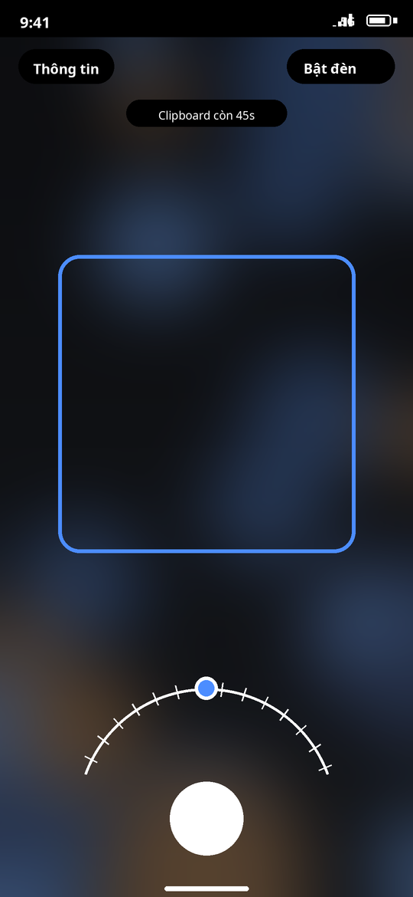
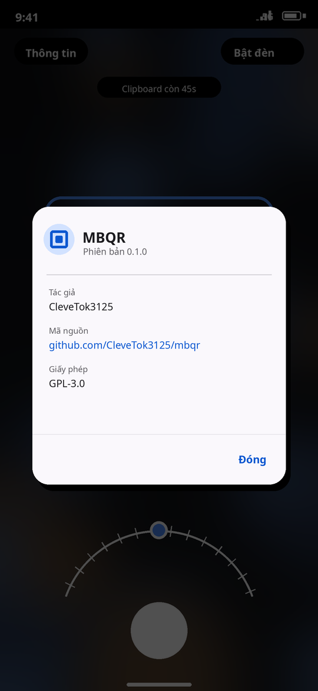

# MBQR

Android QR scanner that hands a VietQR transfer to the MB Bank app.

## What it does

1. Scans a VietQR (NAPAS EMVCo) code with CameraX and ZXing.
2. Builds the text that the MB transfer hub understands:
   `MB <account> <amount in thousands> [recipient name]`.
3. Copies that text to the clipboard and opens `mbbank://?ad_dp=transfer`.
4. Clears the clipboard after 60 seconds, or immediately when the app is
   removed from recents.

## Demo

Static mockups:

<p>
  
  
</p>

## Supported input

- VietQR payloads with the NAPAS provider (`A000000727`).
- VND currency only. Amounts below 5 VND are rejected because the hub reads at
  most two decimal places of the thousands value.
- MB Bank BIN `970422`. Other BINs are shown as a raw payload with a copy
  button instead of being handed off.

## Build

```sh
./gradlew :app:assembleDebug
```

Release builds use `keystore.properties` when it exists:

```properties
storeFile=release.jks
storePassword=...
keyAlias=...
keyPassword=...
```

The release workflow reads `KEYSTORE_PATH`, `KEYSTORE_PASSWORD`, `KEY_ALIAS`,
and `KEY_PASSWORD` from CI secrets instead.

## Release

Push a tag:

```sh
git tag v0.1.0
git push origin v0.1.0
```

The workflow builds a signed `arm64-v8a` APK and publishes it with a
`SHA256SUMS` file.

Required repository secrets:

- `KEYSTORE_BASE64`
- `KEYSTORE_PASSWORD`
- `KEY_ALIAS`
- `KEY_PASSWORD`

## Manual runs

- **CI**: Actions -> `ci` -> Run workflow.
- **Release smoke**: Actions -> `release` -> Run workflow with `publish`
  disabled. The signed APK and checksums are uploaded as artifacts without
  creating a release.
- Enabling `publish` on a manual run creates a release tagged
  `smoke-<run-number>`.

## Behavior notes

- Scanning starts as soon as camera permission is granted.
- Drag the arc dial to zoom. The shutter captures a full-resolution photo and
  decodes it, which extends the usable distance beyond the preview stream.
- Raw payloads that are not a supported VietQR can be copied, shared, or
  opened in a browser when the content is a plain HTTP(S) URL.
- The amount is rounded to two decimal places of the thousands value.
- After a successful handoff the camera stops and a clipboard countdown is
  shown; tap **Quét mã khác** to scan another code.
- Paste the copied text into the MB hub with a long-press. Transfer content is
  entered manually.
- The foreground service only runs while the clipboard entry is alive. It stops
  when the one-minute timer expires or when the task is removed from recents.
- No internet permission, no analytics, no background jobs.
