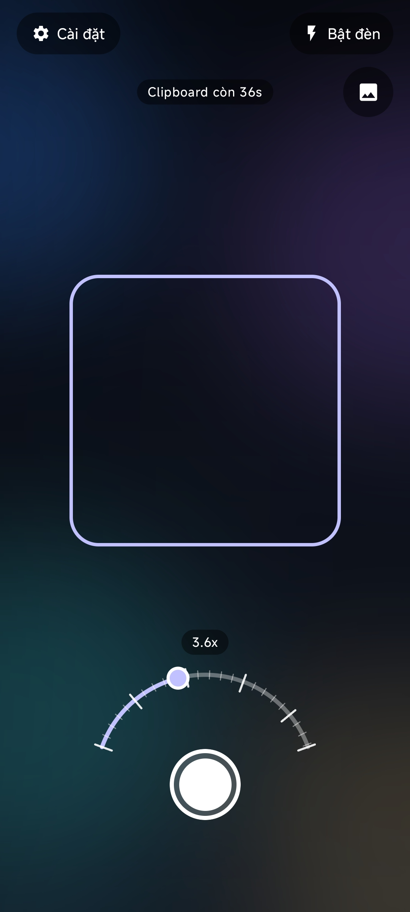
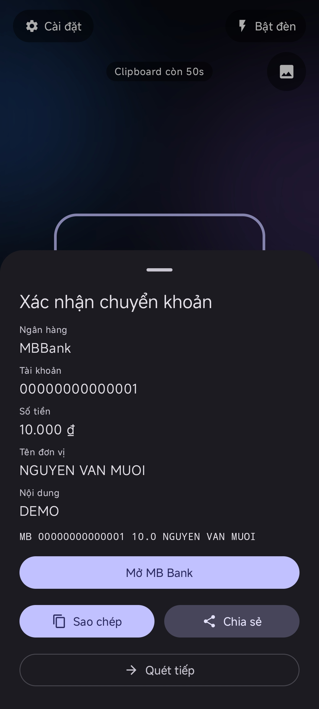
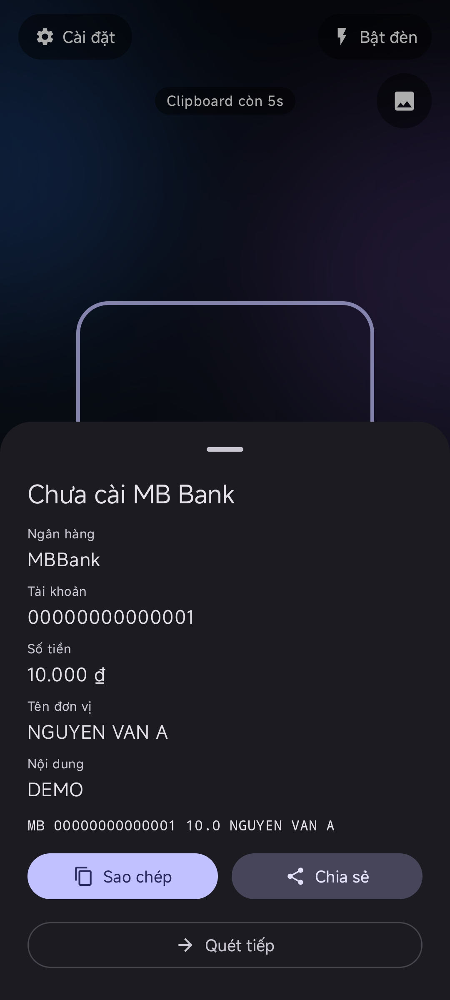
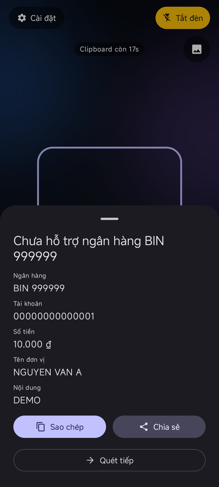
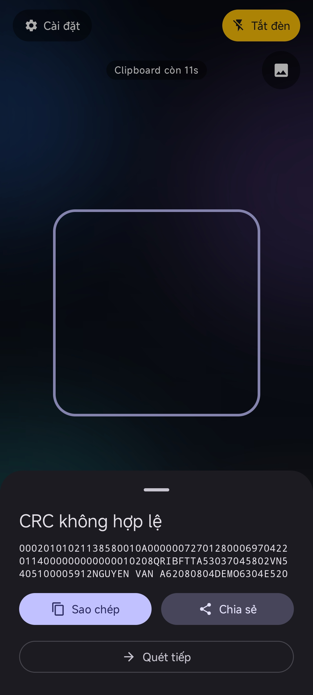
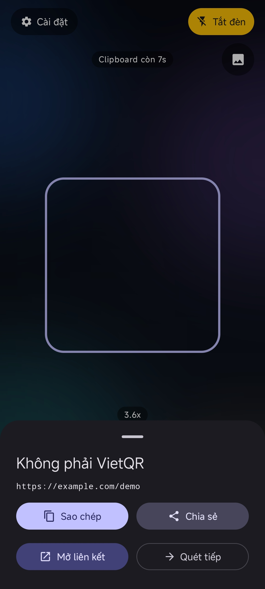

# MBQR

Android QR scanner that hands a VietQR transfer to the MB Bank app and parses
common QR formats.

## What it does

1. Scans a QR code from the camera, a full-resolution capture, a gallery image,
   or one image shared from another app.
2. Builds `<bank> <account> <amount in thousands> [merchant name]` for VietQR.
3. Shows the transfer sheet by default. Confirming copies the text and opens
   `mbbank://?ad_dp=transfer`.
4. Shows parsed details for Wi-Fi, contacts, email, phone, SMS, location, ISBN,
   and links.
5. Clears the clipboard after the configured timer, or on task removal while the
   timer is active.

## Demo

<p>
  
  
  
</p>
<p>
  
  
  
</p>

## Supported input

Only QR Code Model 2 symbols are decoded. Measured symbol limits, capture
guidance, and out-of-spec behaviour are in
[QR symbol support](docs/qr-symbol-support.md).

- VietQR with the NAPAS provider (`A000000727`).
- Wi-Fi (`WIFI:`), vCard/MECARD/BIZCARD, email, phone, SMS/MMS, location, ISBN,
  and HTTP(S) links.
- VND only; amounts below 5 VND are rejected.
- Any BIN in the bundled directory. The directory is generated from
  `https://api.vietqr.io/v2/banks`; the app never requests it at runtime.
- Formats are detected from specific to generic, so `mailto:` and `sms:` are not
  treated as links and `WIFI:` is not treated as text.
- Wi-Fi, contacts, email, phone, SMS, location, and ISBN are parsed and shown
  only; the app does not connect to networks or launch other apps.
- Invalid-CRC VietQR and plain text open a raw sheet that can copy/share.
  HTTP(S) payloads open a link sheet with a browser action. An unsupported bank
  keeps the parsed sheet and previews the raw payload for copy.

## Bank directory

`BankDirectory.kt` is generated from the public VietQR list:

```sh
python3 tools/update_banks.py
```

The file is committed. Builds do not access the network. The generator validates
BIN shape, control characters, duplicates, and minimum list size. A monthly
workflow updates it; the repository must allow Actions to open PRs, and PRs
opened with `GITHUB_TOKEN` may not start CI.

## Build

```sh
./gradlew :app:assembleDebug
```

Release builds use `keystore.properties` when present:

```properties
storeFile=release.jks
storePassword=...
keyAlias=...
keyPassword=...
```

The release workflow reads `KEYSTORE_PATH`, `KEYSTORE_PASSWORD`, `KEY_ALIAS`,
and `KEY_PASSWORD` from CI secrets instead.

## Testing

```sh
./gradlew :app:testDebugUnitTest :app:lintDebug :app:assembleDebug
```

Manual QR fixtures with expected results are in [`test-qr/`](test-qr/);
symbol-level cases are in [`test-qr/hard/`](test-qr/hard). The host decoder
benchmark lives in [`tools/qr_symbol_bench/`](tools/qr_symbol_bench/README.md).

## Release

```sh
git tag v0.1.0
git push origin v0.1.0
```

The workflow builds a signed `arm64-v8a` APK and publishes it with
`SHA256SUMS`.

Required repository secrets: `KEYSTORE_BASE64`, `KEYSTORE_PASSWORD`,
`KEY_ALIAS`, `KEY_PASSWORD`.

## Manual runs

- **CI**: Actions -> `ci` -> Run workflow.
- **Update banks**: Actions -> `update-banks` -> Run workflow; updates the
  directory PR when API data changes.
- **Release smoke**: Actions -> `release` -> Run workflow with `publish`
  disabled; uploads the signed APK and checksums without a release.
- `publish` on a manual run creates a release tagged `smoke-<run-number>`.

## Controls

- **Cài đặt**: full-screen screen with six groups, ordered by how often they
  change: Giao diện, Quét, Tương tác, Tích hợp, Riêng tư, Nâng cao. Each group
  collapses by tapping its header; Nâng cao starts collapsed. **Giao diện** shows
  one shared preview for the frame and margin, then sets the frame outline
  (`Bo góc` default, `Góc`, `Vuông`), the scan margin `0–100%` (default `50`),
  and its outline (`Bo góc` default, `Vuông`). Margin controls are disabled
  until **Chỉ quét trong khung** is on.
  **Quét** holds that toggle. **Tương tác** has **Rung** (default on).
  **Tích hợp** holds the confirmation for opening MB Bank. **Riêng tư** has
  masking (default off) with a live field preview and clipboard expiry (`0` =
  off, otherwise `15–300s` in 15s steps, default `60`). Rows that differ from the
  factory value expose a **Mặc định** action. The overflow menu holds
  **Thông tin** (credits, version, source, license) and **Khôi phục mặc định**.
- **Nâng cao**: **Lọc ký tự không an toàn** (default on) cleans displayed and
  copied values; **Bật copy nâng cao** (default off) adds **Hex** and
  **Base64** copy buttons to the result sheet; **Hiện thông tin xử lý**.
  **Quét trực tiếp** expands to decode preset, analysis resolution, and frame
  rate; **Quét ảnh** expands to the still-image preset. Collapsed rows show the
  current resolution and frame rate.
- **Preset giải mã**: live camera and still images have independent
  `Nhanh` / `Tối đa` presets. Defaults are `Nhanh` for live and `Tối đa` for
  images.
- **Độ phân giải**: independent from presets. Default is `1280×720`;
  fixed sizes are `480p` / `720p` / `1080p`, plus `Khác` with an exact
  camera-supported width/height. If the selected size is unavailable, CameraX
  uses the closest supported size.
- **Tốc độ**: default `24` FPS. Fixed `10 / 24 / 30 / 60` options; values above
  the selected resolution's sensor limit are disabled; `Khác` accepts `1–max`
  FPS. The analyzer throttles to the selected rate.
- **Pipeline status**: optional overlay, off by default, showing the current
  decode stage, source, preset, elapsed time, and result. It is visible only
  while a decode pipeline runs.
- **Đèn / Ảnh**: torch; scan a gallery image or one image shared from another app.
- **Arc dial**: zoom `1x` to camera max; ticks at powers of two, minor ticks per
  interval, final tail clipped at max; haptics at ticks and endpoints when
  **Rung** is on.
- **Shutter**: full-resolution capture.
- **Clipboard pill**: tap to copy again and restart the timer when enabled;
  long-press to clear.

## Behavior

### Scanning

- **Chỉ quét QR trong khung** is off by default. When on, live camera frames are
  cropped to the frame plus the configured margin. Shutter, gallery, and shared
  images scan the full image.
- **Kiểu khung** and **Kiểu lề** change only the outlines. The crop region,
  margin, and decoded area stay the same.
- **Rung** covers the zoom dial, the shutter button, and clipboard copy, restore,
  and clear actions.
- Shared images use the sender's URI once; no gallery or storage permission is
  requested.
- The merchant-name field is appended only when present; MB resolves the
  recipient separately.

### Sanitizing

- **Lọc ký tự không an toàn** runs after parsing: TLV lengths and the VietQR CRC
  are still computed on the original payload, then every displayed value and the
  raw block are cleaned.
- Dropped: control characters (except line feeds and tabs), bidirectional
  controls, zero-width characters, BOM, soft hyphens, and unpaired surrogates.
  Visible characters, Vietnamese diacritics, and emoji are kept.
- Copy, share, and the MB handoff use the cleaned text, so copying matches what
  the sheet displays. Because characters are removed, a copied raw payload can
  be structurally different from the scanned one; the advanced **Hex** and
  **Base64** actions encode the payload exactly as decoded, before normalization,
  sanitizing, or masking.

### Sensitive fields

- **Mức ẩn dữ liệu nhạy cảm** has three levels: `0` off, `1` light, `2` full.
  The default is off.
- Level `1` hides direct secrets and identifiers. Level `2` also hides personal
  context such as names, subjects, and links.
- At level `0`, raw payloads stay visible. At level `2`, the app masks all raw
  payloads. At level `1`, the app masks a raw payload only when it also masks a
  parsed field.
- Tap a masked value or its eye icon to show it. Tap again to hide it.
- Long-press a field to copy the real value without changing the display. When
  you open a sheet again, masked values start hidden.
- See [Sensitive data masking](docs/sensitive-data-masking.md) for the field
  matrix and limits.

### MB handoff

- Without MB Bank, the parsed sheet still offers copy, share, and scan again.
- Confirmation is on by default. The clipboard is written before MB opens; a
  non-zero timer starts then. Off copies and opens MB immediately.
- If MB does not foreground within 5 seconds, the paused screen offers **Mở MB
  Bank**. A second failure reopens the normal transfer sheet via **Mở xác nhận
  chuyển khoản**.
- Supported transfers copy only the bank prefix, account, amount, and merchant
  name.
- Amounts are rounded to two decimal places of the thousands value.
- Paste into the MB hub with a long-press; transfer content is manual.

### Clipboard

- Timer `0` disables auto-clear and the foreground service. The clipboard stays
  until it is overwritten or cleared manually.
- A non-zero timer clears the clipboard on expiry or task removal.
- After handoff, the camera stops and shows a countdown or persistent indicator;
  **Quét mã khác** restarts scanning.

### Demo behavior

- Tap the version line five times in credits. Demo reflects the current clipboard
  and confirmation settings and draws the scan-frame boundary; demo cases are
  not filtered by that frame.
- Demo cycles transfer, missing-MB, unsupported-bank, invalid-CRC, Wi-Fi, contact,
  and link cases.
- With confirmation off, handoff-ready cases only show a demo toast. Sheet actions
  and field copies are no-ops; **Quét tiếp**, swipe down, or back closes.

### Privacy

- No internet permission, analytics, or background work beyond the clipboard
  timer. Parsing is local; a link opens only when the user taps it.

## License

GPL-3.0. See `LICENSE`. ZXing-C++ is used under Apache-2.0.
